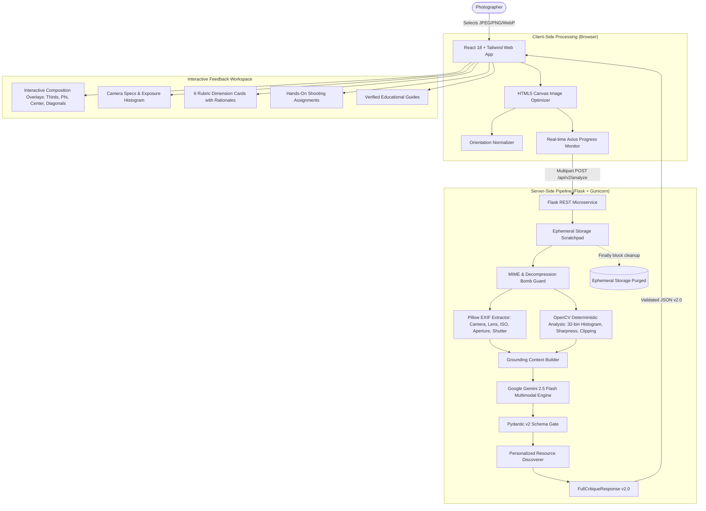

# ArtiSight 2.0 — AI Photo Critique & Photography Learning Assistant

> **Transforming raw photographs into structured, explainable critiques, deterministic computer vision signals, and personalized practice assignments using Multimodal AI.**

[](https://github.com/vdevisricharan/ArtiSight/actions/workflows/ci.yml)
[](LICENSE)
[](https://python.org)
[](https://react.dev)
[](https://ai.google.dev)
[](https://opencv.org)

---

## 🔗 Project Links

- **🌐 Live Web Application:** [https://artisight.netlify.app/](https://artisight.netlify.app/)
- **📑 Portfolio Case Study:** [https://vdevisricharan.netlify.app/project/artisight](https://vdevisricharan.netlify.app/project/artisight)
- **🐙 Source Code Repository:** [https://github.com/vdevisricharan/ArtiSight](https://github.com/vdevisricharan/ArtiSight)

---

## 1. Product Overview

Beginner and intermediate photographers often hit a learning plateau. Social media platforms provide vanity metrics ("likes" and emojis) rather than actionable technical feedback on lighting, framing, or focal plane control. Traditional photography mentoring is expensive, inaccessible, and intermittent.

**ArtiSight 2.0** bridges this gap by acting as an on-demand, intelligent photography mentor. When a photographer uploads an image, ArtiSight evaluates it against classical photographic principles, producing:
1. **6-Dimension Rubric Scoring:** Calibrated evaluation across Composition, Lighting, Focus, Color, Storytelling, and Overall impact.
2. **Deterministic Computer Vision:** OpenCV-calculated 32-bin exposure histograms, highlight/shadow clipping percentages, and Laplacian sharpness variance.
3. **Interactive Composition Overlays:** Real-time visual guides (Rule of Thirds, Phi Ratio, Center Crosshair, Diagonals) rendered over the photograph.
4. **Capture Technical Metadata:** EXIF extraction for camera body, lens, focal length, aperture, shutter speed, and ISO (with automated GPS location redaction).
5. **Personalized Hands-On Assignments:** Concrete shooting exercises designed specifically to correct detected weaknesses.
6. **Curated Educational Resources:** Verified tutorials, articles, and video guides tailored to the identified skill gaps.

---

## 2. System Architecture

ArtiSight is architected as an asynchronous, decoupled client-server application:



---

## 3. The AI & Computer Vision Pipeline

### 3.1 Why Deterministic CV Complements Generative AI
Large vision-language models excel at high-level semantic reasoning (mood, storytelling, color harmony, subject emphasis). However, neural networks cannot calculate exact pixel values or frequency distributions. 

ArtiSight solves this by pairing **OpenCV deterministic algorithms** with **Gemini 2.5 Flash**:

- **Exposure Histogram & Clipping:** OpenCV converts the photograph to grayscale and computes a 32-bin normalized luminance histogram, along with exact pixel percentages for highlight clipping (`luminance > 250`) and shadow clipping (`luminance < 5`).
- **Sharpness Estimation:** Computes the variance of the Laplacian filter:
  $$\text{Sharpness Index} = \text{Var}(\nabla^2 I)$$
  This provides an objective measure of high-frequency edge transition intensity.
- **Grounding Synthesis:** These measured metrics are injected directly into Gemini's prompt context, preventing the model from hallucinating technical flaws that contradict the pixels.

### 3.2 Evaluation of BLIP-2 vs. Gemini 2.5 Flash
Historical artifacts referenced a dual Gemini Vision + BLIP-2 architecture. During the 2.0 modernization, this claim was systematically audited:
- **Footprint:** BLIP-2 requires ~15GB memory and introduces 30–45s of CPU inference latency.
- **Redundancy:** Gemini 2.5 Flash natively outperforms BLIP-2 in aesthetic perception and compositional grounding.
- **Decision:** The unsupported BLIP-2 claim was eliminated in favor of a lean, sub-50ms deterministic OpenCV pipeline, saving gigabytes of RAM and slashing cloud operational costs.

---

## 4. The 6-Dimension Photographic Rubric

Every photograph is evaluated against 6 standardized dimensions (0.0 to 10.0 scale):

| Dimension | Evaluation Criteria |
|---|---|
| **Composition** | Rule of thirds, golden ratio balance, subject placement, leading lines, framing, negative space, visual balance, and cropping. |
| **Lighting & Exposure** | Exposure accuracy, highlight clipping, shadow detail retention, tonal contrast, lighting direction, and dynamic range. |
| **Focus & Clarity** | Subject sharpness, plane of critical focus, intentional depth of field, motion blur control, and apparent sensor noise. |
| **Color & Tones** | White balance neutrality, color palette harmony (complementary, analogous), saturation balance, and tonal gradations. |
| **Storytelling & Subject** | Main subject isolation, emotional resonance, visual hierarchy, mood, and narrative coherence. |
| **Overall Impact** | Memorability, artistic intent, key strengths, and overall execution summary. |

---

## 5. Technology Stack

### Frontend
- **Framework:** React 18, Vite 6
- **Styling:** Tailwind CSS 3
- **State Management:** Redux Toolkit 2 (with `sessionStorage` rehydration)
- **Icons:** Lucide React, Phosphor Icons
- **HTTP Client:** Axios (with true network upload progress tracking)
- **Hosting:** Netlify

### Backend
- **Framework:** Python 3.11, Flask 3.1
- **WSGI Production Server:** Gunicorn 26.2
- **Multimodal AI:** Google Gemini 2.5 Flash via `google-genai` SDK
- **Computer Vision:** OpenCV (`opencv-python-headless` 5.0)
- **Image Processing:** Pillow 12.3 (with `ImageOps.exif_transpose`)
- **Schema Validation:** Pydantic v2.14
- **Testing:** Pytest 9.1
- **API Documentation:** Flasgger (OpenAPI / Swagger 2.0)

---

## 6. Performance Benchmarks

Measured on authentic photographic test fixtures using `scripts/benchmark.py`:

| Component | p50 Duration | Mean Duration | Notes |
|---|---|---|---|
| **EXIF Extraction** | 9.0 ms | 13.1 ms | Strips GPS tags for privacy |
| **OpenCV CV Analysis** | 42.9 ms | 46.1 ms | 32-bin histogram, clipping, Laplacian variance |
| **Resource Retrieval** | 0.1 ms | 0.1 ms | Curated database matching |
| **Multimodal AI Inference** | 13.21 s | 14.12 s | Gemini 2.5 Flash with 512-token thinking budget |
| **Total End-to-End Pipeline** | **13.26 s** | **14.18 s** | Upload to structured dashboard render |

*Note: Historical documentation claimed "sub-4 second turnaround." Benchmark evidence demonstrates that high-quality multimodal reasoning across 6 dimensions requires ~13 seconds, while local OpenCV operations execute in under 50 milliseconds.*

---

## 7. API Reference

Interactive Swagger documentation is available at `http://localhost:5000/apidocs` when running the backend.

### Core Endpoints

#### `GET /health`
Returns system health, active AI model, search provider status, and uptime.

#### `POST /api/v2/analyze`
**Request:** Multipart form data with `file` (JPEG, PNG, WebP up to 16MB).  
**Response:**
```json
{
  "schemaVersion": "2.0",
  "analysisId": "e3b0c442-98fc-1c14-9afb-4c8996fb9242",
  "image": {
    "width": 1920,
    "height": 1080,
    "aspectRatio": "16:9 Widescreen"
  },
  "summary": {
    "title": "Serene Island Reflection in Calm Waters",
    "observations": ["Calm water with clear reflection", "Rocky island as primary subject"],
    "strengths": ["Excellent natural color harmony", "Well-controlled highlight details"],
    "improvements": ["Subject placement could align more strictly with third-grid"]
  },
  "scores": {
    "composition": {"value": 8.0, "rationale": "Balanced horizon with gentle asymmetry."},
    "lighting": {"value": 9.0, "rationale": "Soft diffused daylight without harsh clipping."},
    "focus": {"value": 8.5, "rationale": "Crisp foreground details with natural falloff."},
    "color": {"value": 8.5, "rationale": "Pleasing complementary blue and earthy tones."},
    "storytelling": {"value": 8.0, "rationale": "Evokes quiet solitude and tranquil atmosphere."},
    "overall": {"value": 8.4, "rationale": "A strong, technically sound landscape photograph."}
  },
  "recommendations": [
    {
      "problem": "Center-heavy composition reduces dynamic tension",
      "evidence": "Island is positioned near vertical centerline",
      "why_it_matters": "Off-center placement creates visual movement",
      "recommendation": "Shift camera to place island along left or right third",
      "exercise": "Take 3 photos of the same landmark at left, center, and right thirds",
      "expected_outcome": "Mastery of deliberate asymmetric balance",
      "learning_topic": "Composition"
    }
  ],
  "cvMetrics": {
    "sharpnessIndex": 438.4,
    "sharpnessAssessment": "Good overall focus and discernible edge sharpness.",
    "brightnessMean": 128.4,
    "contrastRms": 52.1,
    "highlightClippingPercent": 0.0,
    "shadowClippingPercent": 0.2,
    "exposureEvaluation": "Well-balanced midtone exposure across the frame.",
    "luminanceHistogram": [12, 25, 45, 80, 95, 70, 40, ...],
    "dominantColorHex": "#4a627a"
  },
  "exifData": {
    "hasExif": false,
    "cameraMake": null,
    "cameraModel": null
  },
  "resources": [
    {
      "title": "Rule of Thirds in Photography: Complete Guide with Visual Examples",
      "link": "https://photographylife.com/rule-of-thirds",
      "snippet": "Learn how the rule of thirds guides the viewer's eye...",
      "displayLink": "photographylife.com",
      "sourceType": "guide"
    }
  ],
  "metadata": {
    "model": "gemini-2.5-flash",
    "processingTimeMs": 13260,
    "timestamp": "2026-10-14T08:38:40.519Z",
    "schemaVersion": "2.0"
  }
}
```

---

## 8. Development & Setup

### 8.1 Prerequisites
- **Node.js**: v18.0.0 or higher
- **Python**: v3.11 or higher
- **Google AI Studio API Key**: For Gemini 2.5 Flash

### 8.2 Backend Setup
```bash
cd backend

# Create virtual environment
python -m venv .venv
source .venv/bin/activate       # On Windows: .venv\Scripts\activate

# Install dependencies
pip install -r requirements.txt

# Configure environment
cp .env.example .env
# Edit backend/.env and insert your GEMINI_API_KEY

# Run tests
pytest

# Start backend server
python run.py
```

### 8.3 Frontend Setup
```bash
cd artisight

# Install dependencies
npm install

# Start Vite development server
npm run dev
```
Open [http://localhost:5173](http://localhost:5173) in your browser.

### 8.4 Docker Compose Setup
To run the full stack in synchronized production containers:
```bash
docker-compose up --build
```
- Frontend: `http://localhost:5173`
- Backend: `http://localhost:5000`

---

## 9. Privacy & Security

- **Zero Permanent Storage:** Uploaded photographs are processed statelessly in ephemeral temporary files and deleted immediately upon analysis completion.
- **GPS Location Stripping:** EXIF location coordinates (`GPSInfo`) are explicitly excluded and sanitized before any processing occurs.
- **Decompression Bomb Protection:** Pillow's pixel ceiling is bounded at 100 Megapixels to prevent memory-exhaustion payloads.
- **Client Credential Isolation:** Zero API keys or secrets are exposed in client-side bundles.

---

## 10. Historical Project References

This project builds upon the foundational research conducted at IIIT Delhi (2024, Group 12):
- [ArtiSight Presentation Slides](ArtiSight%20Presentation.pdf)
- [ArtiSight Academic Project Report](ArtiSight__A_Personalized_AI_Photo_Critique_Platform.pdf)
- [ArtiSight Video Demo](ArtiSight%20Demo.mp4)

---

## 11. License

Distributed under the MIT License. See [LICENSE](LICENSE) for more information.
