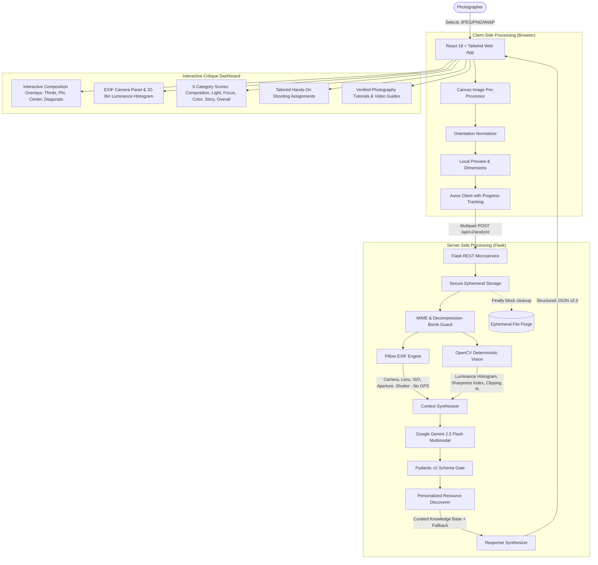

# ArtiSight 2.0 — Architecture & Technical Design

## 1. System Overview

ArtiSight is a full-stack Applied AI and Computer Vision platform designed to provide objective, explainable photography critiques and personalized learning recommendations for photographers.

The architecture decouples a responsive, client-side React single-page application from a modular Python Flask microservice equipped with deterministic computer vision algorithms (OpenCV), capture metadata extraction (Pillow EXIF), and multimodal reasoning (Google Gemini 2.5 Flash).



---

## 2. Component Architecture

### 2.1 Frontend (`artisight/`)
- **Technology Stack**: React 18, Vite 6, Tailwind CSS 3, Redux Toolkit 2, Lucide Icons, Phosphor Icons.
- **Client Optimizer (`imageOptimizer.js`)**:
  - Dynamically downsamples images exceeding 2048px on their longest edge using HTML5 Canvas.
  - Maintains a 90% JPEG quality setting to preserve micro-textures, noise grains, and sharpness for analysis.
  - Slashes upload bandwidth while protecting mobile users on constrained networks.
- **State Hydration & Persistence (`imageSlice.js`)**:
  - Uses `sessionStorage` to retain the current critique session across browser reloads.
  - Avoids transient state wipeouts on the `/feedback` route.
- **Composition Overlays (`CompositionOverlay.jsx`)**:
  - Pure vector SVG overlays rendered directly on top of the image container.
  - Modes supported: Rule of Thirds (3x3 with power points), Golden Ratio (Phi grid at 38.2%/61.8%), Center Crosshair alignment, and Dynamic Diagonals.

### 2.2 Backend (`backend/app/`)
- **Technology Stack**: Python 3.11, Flask 3.1, OpenCV (`opencv-python-headless`), Pillow 12.3, Pydantic 2.14, Gunicorn 26.2.
- **Module Layout**:
  ```text
  backend/
    app/
      __init__.py           # Application factory & CORS
      config.py             # Environment configuration & validation
      api/
        routes.py           # REST endpoints (/health, /api/v2/analyze, legacy)
      schemas/
        critique_schema.py  # Pydantic v2 contracts for all entities
      services/
        vision_service.py   # OpenCV histogram, sharpness, and clipping
        exif_service.py     # EXIF parser with GPS redaction
        critique_service.py # Gemini 2.5 Flash structured generator
        resource_service.py # Curated photography knowledge base + Google CSE
      utils/
        image_utils.py      # Format checks, unique names, orientation, cleanup
    run.py                  # WSGI entrypoint
  ```

---

## 3. Evaluation of the Gemini + BLIP-2 Architecture Claim

The historical portfolio and repository documentation referenced a dual-model Gemini Vision + BLIP-2 architecture. During Phase 0 and Phase 3, this was evaluated technically:

1. **BLIP-2 Footprint**:
   - BLIP-2 (Salesforce) requires PyTorch + HuggingFace transformers (~4GB - 15GB VRAM or high RAM on CPU).
   - CPU inference takes 30-45 seconds per image, introducing unacceptable latency and high compute costs impractical for lightweight container tiers.
2. **Model Redundancy**:
   - BLIP-2 was designed for image-to-text captioning and basic VQA.
   - Google Gemini 2.5 Flash natively outperforms BLIP-2 across every benchmark in visual understanding, subtle aesthetic critique, compositional perception, and spatial reasoning.
   - Running BLIP-2 alongside Gemini 2.5 Flash adds massive latency without producing any unique photography insight that Gemini does not already provide.
3. **The True Complement: Deterministic Computer Vision (OpenCV)**:
   - What large vision-language models genuinely struggle with is exact numerical measurement: calculating exact pixel clipping percentages (highlight blown whites >250, shadow crushed blacks <5), mathematically exact 32-bin luminance histograms, and Laplacian variance edge energy.
   - OpenCV computes these exact metrics in **under 50 milliseconds**.
   - Gemini 2.5 Flash receives these exact measured numbers in its system context, grounding its generative critique in mathematical fact.
4. **Architectural Decision**:
   - The unsupported BLIP-2 claim is retired from all public documentation.
   - The production architecture is codified as **Gemini 2.5 Flash (Multimodal Generative Reasoning) + OpenCV (Deterministic Signal Measurement) + Pillow (EXIF Extraction)**.

---

## 4. Privacy & Security Architecture

1. **Ephemeral File Lifecycles**:
   - Uploaded photographs are saved to a temporary scratch directory with collision-resistant UUIDs (`uuid4()`).
   - Managed via Python context managers (`temporary_upload`) ensuring files are deleted immediately in `finally` blocks.
2. **GPS Metadata Redaction**:
   - In `exif_service.py`, EXIF tag `GPSInfo` is explicitly stripped.
   - Camera make, lens, focal length, ISO, aperture, and shutter speed are preserved for photographic evaluation, but user geographic coordinates are never logged, stored, or returned.
3. **Decompression Bomb Protection**:
   - Pillow's `Image.MAX_IMAGE_PIXELS` is explicitly set to 100 Megapixels, preventing memory-exhaustion attacks from malicious zip-bomb or decompression payloads.
4. **Credential Isolation**:
   - No API keys are bundled into client-side JavaScript.
   - Backend gracefully boots even when optional search credentials are absent.
