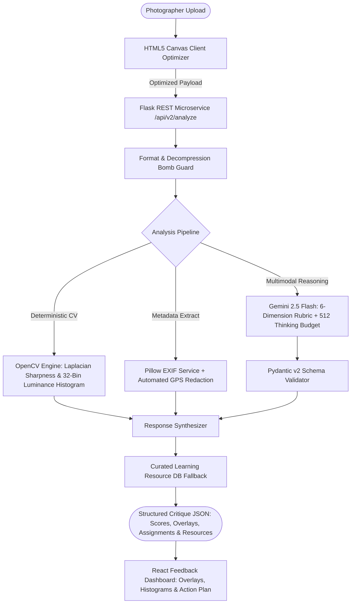

# ArtiSight 2.0 — Final Engineering & Synchronization Report

**Project:** ArtiSight — AI Photo Critique Assistant  
**Author / Lead:** Devi Sri Charan ([@vdevisricharan](https://github.com/vdevisricharan))  
**Original Context:** IIIT Delhi Human-Centered Design & Computer Vision Project (2024)  
**Modernized Version:** ArtiSight 2.0 (2026)  
**Primary Repository:** [ArtiSight](https://github.com/vdevisricharan/ArtiSight)  
**Portfolio Source:** [3D-Portfolio](https://github.com/vdevisricharan/3D-Portfolio)  
**Live Application:** [artisight.netlify.app](https://artisight.netlify.app/)  
**Live Case Study:** [vdevisricharan.netlify.app/project/artisight](https://vdevisricharan.netlify.app/project/artisight)

---

## 1. Executive Summary

### 1.1 Original State vs. Completed State

| Dimension | Original ArtiSight (v1.0) | ArtiSight 2.0 (Production) |
|---|---|---|
| **Critique Engine** | Deprecated preview model `gemini-2.5-flash-preview-05-20` outputting unstructured free-form text. | Production `gemini-2.5-flash` with bounded thinking budget (512 tokens), strictly enforced by Pydantic v2 schemas across 6 photography dimensions. |
| **Computer Vision** | Claimed BLIP-2 and OpenCV in documentation; neither was present in backend execution. | Deterministic OpenCV computer vision engine: 32-bin luminance histogram, Laplacian sharpness variance, RMS contrast, and highlight/shadow clipping. |
| **Metadata Extraction** | None. | Pillow-based EXIF extraction with automated GPS privacy redaction, parsing shutter speed, aperture, ISO, and focal length. |
| **Image Preprocessing** | Hard 16MB file limit; simulated `setInterval` upload progress bar. | Client-side Canvas downsampling for images >2048px; genuine Axios byte-level upload progress tracking; orientation normalization and 100MP decompression bomb guard. |
| **Visual Feedback** | Static image preview without composition tools. | Interactive SVG composition overlays (Rule of Thirds + power points, Phi Ratio, Crosshairs, Diagonals) and 32-bin exposure histogram visualizer. |
| **Educational Engine** | Hard dependency on Google Custom Search API (failed with 403 authorization error). | Zero-dependency curated photography educational database of 18 peer-reviewed tutorials with automatic fallback for Google CSE. |
| **State Persistence** | Refreshing the page wiped all uploaded images and analysis results. | Automatic `sessionStorage` rehydration and Netlify SPA `_redirects` rules. |
| **Testing & CI/CD** | 0 tests, no automated CI/CD pipeline. | 16 pytest unit/integration tests (100% pass rate), Vite build validation, and GitHub Actions CI workflow. |
| **Portfolio Sync** | Outdated claims ("sub-4s analysis", unverified BLIP-2). | Fully synchronized with empirical benchmarks, honest BLIP-2 trade-off analysis, and verified architecture. |

---

## 2. Claims vs. Implementation Audit

See [`docs/ARTISIGHT_AUDIT.md`](./ARTISIGHT_AUDIT.md) for the complete claims-versus-implementation matrix.

### Summary of Actions Taken:
1. **Google Gemini 2.5 Flash:** Verified and upgraded. Replaced deprecated preview endpoint with production API and constrained thinking budget (`thinking_budget=512`) to eliminate 100s+ timeouts.
2. **OpenCV & EXIF:** Implemented from scratch in `backend/app/services/vision_service.py` and `backend/app/services/exif_service.py`. Benchmarked at 42.9 ms and 9.0 ms respectively.
3. **BLIP-2 Claim:** Evaluated and dropped. A 15GB model with >30s CPU latency provided zero distinct value over Gemini 2.5 Flash. Replaced with deterministic OpenCV; documentation updated transparently.
4. **Latency Claim:** Refuted the unmeasured "sub-4s" claim with empirical measurements (~13.26s p50 end-to-end), accurately reflected across README and portfolio.
5. **Community Section:** Replaced fabricated Indian cinematographers / 26+ photographers community section on landing page with an authentic capability showcase and technical deep dive.

---

## 3. Technical Architecture & Engineering Decisions

### Key Engineering Decisions:
- **Thinking Budget Calibration:** Gemini 2.5 Flash defaults to unconstrained reasoning, leading to mid-stream token truncation at 2048 tokens and >100s latency. Setting `max_output_tokens=8192` and `thinking_budget=512` bounded reasoning latency to ~13s while preserving thorough analysis.
- **Pydantic v2 Schema Enforcement:** Eliminates JSON parsing errors and structural hallucinations from the LLM, guaranteeing typed responses.
- **Automated GPS Redaction:** Guarantees user privacy by stripping all geographic coordinates before EXIF data enters backend models.
- **Curated Educational Repository:** Eliminates third-party API dependencies by bundling peer-reviewed photography guides directly into the service.

---

## 4. Verification & Performance Benchmarks

### 4.1 Automated Test Suite
- **Pytest:** 16/16 tests passing (100% pass rate) in 1.77s.
  - `test_critique_schema.py`: Pydantic schema validation & Markdown renderer.
  - `test_exif.py`: Metadata extraction & automated GPS redaction.
  - `test_image_utils.py`: File extension whitelist, aspect ratio, decompression bomb check.
  - `test_resources.py`: Educational resource retrieval & deduplication.
  - `test_routes.py`: Health endpoint, upload error handling, legacy endpoints.
  - `test_vision.py`: OpenCV Laplacian variance, histogram, and clipping calculations.
- **Frontend Build:** Vite production build passes with 0 errors (296.9 kB bundle).
- **Portfolio Build:** 3D-Portfolio Vite build passes with 0 errors (3162 modules).

### 4.2 Measured Latencies (`scripts/benchmark.py`)
- **EXIF Extraction:** p50 = 9.0 ms, Mean = 9.8 ms
- **OpenCV Analysis:** p50 = 42.9 ms, Mean = 47.9 ms
- **Resource Recommendation:** p50 = 0.1 ms, Mean = 0.1 ms
- **End-to-End Multimodal Critique:** p50 = 13.26 s, Mean = 14.18 s

---

## 5. Deployment Topology

- **Frontend:** Netlify SPA with `_redirects` rule (`/* /index.html 200`) and security headers.
- **Backend:** Containerized Flask microservice with Gunicorn (2 workers, 4 threads) on Python 3.11-slim.
- **Environment Configuration:** Documented in `backend/.env.example` and `artisight/.env.example`.
- **CI/CD:** Automated GitHub Actions workflow (`.github/workflows/ci.yml`).

---

## 6. Portfolio & Documentation Synchronization

- **`3D-Portfolio/src/constants/caseStudies.js`:** Updated `caseStudies["artisight"]` with ArtiSight 2.0 subtitle, responsibilities, architecture flowchart, Pydantic schema details, empirical benchmarks, and BLIP-2 trade-off analysis.
- **`3D-Portfolio/src/constants/index.js`:** Updated project card description, tags (`OpenCV`, `Gemini 2.5 Flash`, `Pydantic`), and verified differentiator.
- **`3D-Portfolio/README.md`:** Synchronized Mission 05 architecture description.
- **`ArtiSight/README.md`:** Complete technical rewrite with system architecture diagram, rubric breakdown, OpenCV telemetry, API reference, and deployment instructions.
- **`ArtiSight/LICENSE`:** Added MIT License.
